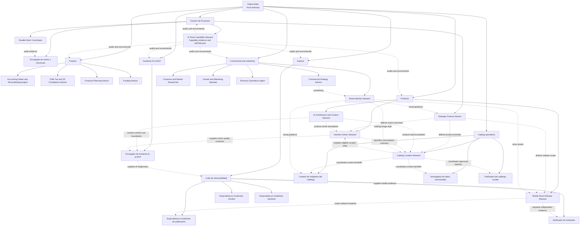

# AI Team Organization

Status: active
Last reviewed: 2026-11-19

## Relationship semantics

- Solid lines group an operational responsibility or a delegation path.
- Dotted lines show capability governance. The Capability Steward does not manage
  the daily output of every role.
- Felipe can converse directly with every role and remains the final authority.
- Felipe defines the team's composition and mandates. The Capability Steward
  documents evidence and recommends changes only when Felipe requests advice.
- Gestión de Proyectos contains capability stewardship, strategic product advice,
  parallel-work coordination, and branch/checkout stewardship. The Strategic
  Product Advisor still evaluates product bets and user outcomes across projects;
  organizational placement does not transfer product implementation authority.
- Producto contains the Nutrition Solver Steward, AI Architecture and Context
  Steward, and Mobile Store Release Steward. Architecture and Context helps an AI
  understand the codebase and its current boundaries before changing it.
- Asistente AI & MCP contains the role visibly named Encargado de Asistente AI &
  MCP. Soporte contains Observability Lead and its mobile, backend, release, and
  independent verification specialists.
- The Branch and Checkout Steward owns requested Git branch, PR, and worktree
  lifecycle actions. Parallel Work Coordinator owns the read-only simultaneous
  work audit and Metro coordination. They share evidence but do not duplicate
  ownership of mutations.
- Coordinators delegate only when specialization or independent evidence adds
  value. Simple work stays with one role.
- Specialists may collaborate temporarily across boundaries, then return a compact
  evidence packet to the coordinator or Felipe.
- Catalog Operations is a permanent operating area. Its steward maintains catalog
  data quality and preparation; Product determines which coverage creates value,
  and Architecture protects authoritative data boundaries.
- Felipe defined three catalog specialists: the image creator prepares approved
  visual assets, the nutrition researcher provides source-linked dossiers, and
  the publisher executes approved data and image batches in staging and
  production. They are peers in Catalog Operations; the Catalog Curation Steward
  coordinates review handoffs and maintains the area's quality and review queue.
- The Nutrition Solver Steward owns solver quality criteria, consumption
  contracts, evaluation evidence, and the improvement backlog. Catalog Operations
  owns the source data and publication process; neither role silently changes the
  other's authority.
- The Encargado de Asistente AI & MCP owns implementation and evaluation of the
  assistant, governed action mechanisms, model integration, MCP projection, and
  AI release evidence. Architecture protects the wider system boundaries, while
  domain roles retain their calculation, data, and product authorities.
- The Mobile Store Release Steward owns release identity, reusable readiness
  evidence, submission coordination, App Store Connect operating state, and the
  recommendation to submit or hold. Product owns release scope, technical roles
  own implementation, Observability supplies health evidence, Release Incident
  Specialist investigates delivery failures, and Incident Verifier supplies
  independent final evidence when required.

## Role classes

- **Advisor:** analyzes evidence and recommends a decision.
- **Coordinator:** triages work and routes bounded investigations.
- **Operator:** executes a defined process within explicit authority.
- **Specialist:** investigates or solves a specific domain boundary.
- **Verifier:** independently checks evidence and closure conditions.
- **Steward:** maintains the quality and coherence of a durable system.

The class describes the role's primary posture, not permission to write or act in
external systems.

## Shared workflow skills

Shared workflow skills provide repeatable procedures to several roles without
creating another reporting relationship. They remain outside the organigram and
do not transfer ownership or authority. Current pilots are:

- `fresh-task-checkout`, which establishes a freshly fetched remote base and an
  isolated checkout before technical work begins;
- `mobile-simulator-review`, which establishes source, Metro, native-build, and API
  identity before presenting a mobile change for visual review.
- `publish-to-staging`, which validates and publishes the exact completed task to
  the current staging integration boundary and verifies remote CI. Checkout and
  branch housekeeping remain a separate requested outcome.
