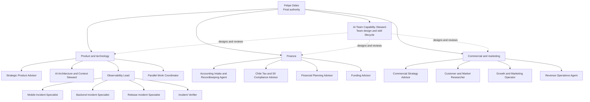

# AI Team Organization

Status: active
Last reviewed: 2026-10-29

## Relationship semantics

- Solid lines group an operational responsibility or a delegation path.
- Dotted lines show capability governance. The Capability Steward does not manage
  the daily output of every role.
- Felipe can converse directly with every role and remains the final authority.
- Coordinators delegate only when specialization or independent evidence adds
  value. Simple work stays with one role.
- Specialists may collaborate temporarily across boundaries, then return a compact
  evidence packet to the coordinator or Felipe.

## Role classes

- **Advisor:** analyzes evidence and recommends a decision.
- **Coordinator:** triages work and routes bounded investigations.
- **Operator:** executes a defined process within explicit authority.
- **Specialist:** investigates or solves a specific domain boundary.
- **Verifier:** independently checks evidence and closure conditions.
- **Steward:** maintains the quality and coherence of a durable system.

The class describes the role's primary posture, not permission to write or act in
external systems.

## Shared workflow skills

Shared workflow skills provide repeatable procedures to several roles without
creating another reporting relationship. They remain outside the organigram and
do not transfer ownership or authority. Current pilots are:

- `fresh-task-checkout`, which establishes a freshly fetched remote base and an
  isolated checkout before technical work begins;
- `mobile-simulator-review`, which establishes source, Metro, native-build, and API
  identity before presenting a mobile change for visual review.
- `publish-to-staging`, which validates and publishes the exact completed task to
  the current staging integration boundary, verifies remote CI, and closes only
  the integrated task checkout.
