# Propuesta visual para los conflictos del Food Catalog (v0.1)

Status: active — propuesta editorial; sin integración en la app

Fecha: 2026-11-12. Felipe aprobó los cuatro bocetos del primer lote, los seis conceptos del segundo y los diez conceptos de cada uno de los lotes tercero, cuarto, quinto y sexto; el yogur aprobado es la versión en pote, mientras que el cuenco se conserva como referencia para salsas/cremas. Para frambuesa eligió definitivamente la variante de dos frutos sin partes verdes y con cavidad visible (`raspberry-v2`).

Fuente: planilla [Food Catalog central — 219 alimentos y porciones](https://docs.google.com/spreadsheets/d/13hEtHnxwfsPI0j0BuTfloPqoqaVRRSGVXAjFjNuKOoE/edit#gid=2005160404), pestaña `Alimentos`, filas 5–223, columnas B/E/O/P/X/Y/Z/AA. La auditoría histórica marca 103 «Crear icono», 36 «Compartir icono», 3 «Cambiar emoji» y 77 «Mantener». Esta tabla cubre los **142 alimentos con acción pendiente** mediante **106 conceptos visuales**; agrupar variantes no equivale a afirmar que todos los estados se vean idénticos.

Decisión curatorial: para almejas, la planilla proponía 🦪, pero [Unicode lo denomina «oyster»](https://www.unicode.org/emoji/charts/full-emoji-list.html); se propone en cambio un icono original de almeja. Así, esta propuesta contiene 104 conceptos ilustrados (62 con boceto seleccionado: 2 recuperados, 50 aprobados por Felipe y 10 propuestos en el lote actual) y 2 cambios Unicode. Son direcciones gráficas específicas, no 104 archivos terminados. Los originales y vistas de revisión se conservan en `assets/visual_identity_catalog/`; los demás requieren producir y probar el arte a 20/24/41 px. La aprobación conceptual de un boceto no implica su integración en el producto.

| Boceto visible | Archivo |
|---|---|
| Acelga | [Abrir](assets/visual_identity_catalog/chard-prototype.png) |
| Garbanzo | [Abrir](assets/visual_identity_catalog/chickpea-prototype.png) |
| Almeja | [Abrir](assets/visual_identity_catalog/clam-prototype.png) |
| Chirimoya | [Abrir](assets/visual_identity_catalog/cherimoya-prototype.png) |
| Tofu | [Abrir](assets/visual_identity_catalog/tofu-prototype.png) |
| Trucha arcoíris | [Abrir](assets/visual_identity_catalog/trout-prototype.png) |

### Segundo lote · aprobado conceptualmente

| Alimento del catálogo | Vista reducida | Archivo original | Reutilización propuesta |
|---|---|---|---|
| Alcachofa cocida | 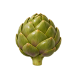 | [PNG](assets/visual_identity_catalog/artichoke-prototype.png) | Un concepto para esta ficha. |
| Alga kelp cruda | 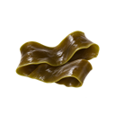 | [PNG](assets/visual_identity_catalog/kelp-prototype.png) | Un concepto para esta ficha. |
| Arvejas de ojo negro cocidas; secas | 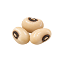 | [PNG](assets/visual_identity_catalog/black-eyed-peas-prototype.png) | Base compartida; revisar variante cocida. |
| Avena tradicional | 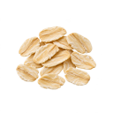 | [PNG](assets/visual_identity_catalog/oats-prototype.png) | Un concepto para esta ficha. |
| Carne molida de vacuno magra cruda | 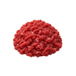 | [PNG](assets/visual_identity_catalog/ground-beef-prototype.png) | Un concepto para esta ficha. |
| Yogur griego natural sin azúcar; natural descremado; natural entero | 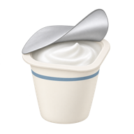 | [PNG](assets/visual_identity_catalog/yogurt-pot-prototype.png) | Pote aprobado; el [cuenco anterior](assets/visual_identity_catalog/yogurt-prototype.png) se reserva como referencia para salsas/cremas. No inventar diferencias visuales por grasa. |

Método: imagen raster generada con la herramienta integrada, fondo transparente, con almeja y tofu aprobados como referencias de estilo. Las vistas reducidas son muestras de 128 px; queda pendiente la prueba de legibilidad a 20/24/41 px y contraste en temas claro/oscuro. Se descartaron las primeras variantes de kelp, avena y carne molida por resplandor, forma de grano y hebras excesivas, respectivamente.

### Tercer lote · diez conceptos en orden, aprobado conceptualmente

Se saltan bocetos ya trabajados y los dos cambios Unicode que no requieren ilustración. Las diez propuestas cubren doce fichas del inventario.

| # de la tabla | Alimento(s) | Vista de revisión | Original | Observación |
|---:|---|---|---|---|
| 5 | Almendras | 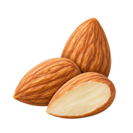 | [PNG](assets/visual_identity_catalog/almond-prototype.png) | Una partida muestra la pulpa. |
| 6 | Anchoa cruda | 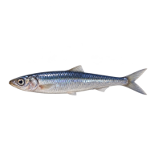 | [PNG](assets/visual_identity_catalog/anchovy-prototype.png) | Pez entero fino, distinto del bacalao. |
| 7 | Apio crudo | 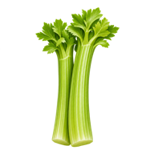 | [PNG](assets/visual_identity_catalog/celery-prototype.png) | Dominan los tallos. |
| 8 | Apio nabo crudo | 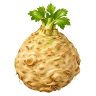 | [PNG](assets/visual_identity_catalog/celeriac-prototype.png) | Domina la raíz bulbosa; segunda generación sin halo. |
| 11 | Arvejas partidas cocidas | 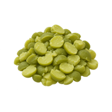 | [PNG](assets/visual_identity_catalog/split-peas-prototype.png) | Mitades visibles; segunda generación para evitar aspecto de aceitunas. |
| 13 | Atún en agua drenado | 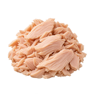 | [PNG](assets/visual_identity_catalog/tuna-drained-prototype.png) | Porción en hebras, no pez entero. |
| 15 | Bacalao crudo | 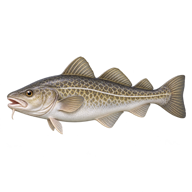 | [PNG](assets/visual_identity_catalog/cod-prototype.png) | Tres aletas dorsales y barbilla. |
| 16 | Berro crudo | 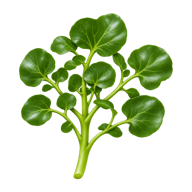 | [PNG](assets/visual_identity_catalog/watercress-prototype.png) | Hojas pequeñas y redondeadas. |
| 17 | Betarraga cruda; cocida | 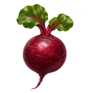 | [PNG](assets/visual_identity_catalog/beet-prototype.png) | Base cruda; revisar si la cocida requiere variante sin hojas. |
| 18 | Bok choy crudo; cocido | 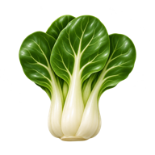 | [PNG](assets/visual_identity_catalog/bok-choy-prototype.png) | Base cruda; revisar si la cocida requiere variante. |

Método: diez llamadas independientes a la generación de imágenes integrada, con los prototipos aprobados como referencias de estilo; recortes de alimento con fondo transparente, silueta compacta y sin marca ni texto. Las vistas de revisión son de 192 px para evitar la pixelación de una muestra reducida a píxeles físicos; no sustituyen una comprobación dentro de la app. El lote no se ha publicado ni conectado al catálogo operativo.

### Cuarto lote · diez conceptos en orden, aprobado por Felipe

Se salta carne molida (#23) y chirimoya (#25), que ya tienen boceto. Hay once imágenes para diez conceptos porque la ciruela fresca y la seca reciben versiones propias. Las carnes de cabra y conejo son representaciones de cortes y no pueden probar especie por imagen sola: el nombre debe acompañarlas siempre.

| # de la tabla | Alimento(s) | Vista de revisión | Original | Observación |
|---:|---|---|---|---|
| 19 | Caqui crudo | 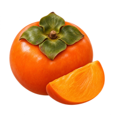 | [PNG](assets/visual_identity_catalog/persimmon-prototype.png) | Cáliz de cuatro hojas y pulpa naranja. |
| 20 | Carambola cruda | 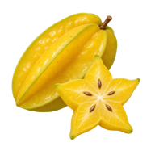 | [PNG](assets/visual_identity_catalog/starfruit-prototype.png) | Rodaja en estrella. |
| 21 | Carne de cabra cruda | 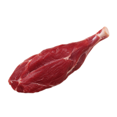 | [PNG](assets/visual_identity_catalog/goat-meat-prototype.png) | Corte magro oscuro con hueso; no usar sin nombre. |
| 22 | Carne de conejo cruda | 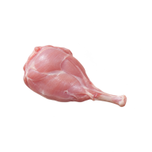 | [PNG](assets/visual_identity_catalog/rabbit-meat-prototype.png) | Porción rosada clara; no usar sin nombre. |
| 24 | Cebollín crudo | 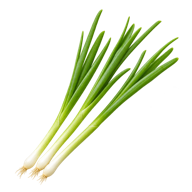 | [PNG](assets/visual_identity_catalog/scallion-prototype.png) | Tallos finos y bulbos pequeños, no puerro. |
| 26 | Chirivía cruda; cocida | 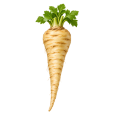 | [PNG](assets/visual_identity_catalog/parsnip-prototype.png) | Base cruda; pendiente decidir variante cocida. |
| 27 | Ciruela cruda; seca | 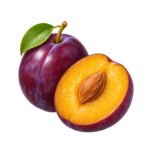 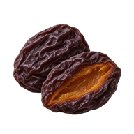 | [Fresca](assets/visual_identity_catalog/plum-fresh-prototype.png) · [Seca](assets/visual_identity_catalog/plum-dried-prototype.png) | Dos imágenes para conservar la diferencia de estado. |
| 28 | Clara de huevo | 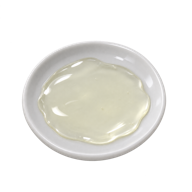 | [PNG](assets/visual_identity_catalog/egg-white-prototype.png) | Representa clara líquida sin yema; verificar estado de la ficha antes de integrar. |
| 29 | Coliflor cruda; cocida | 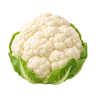 | [PNG](assets/visual_identity_catalog/cauliflower-prototype.png) | Base cruda; pendiente decidir variante cocida. |
| 30 | Colinabo crudo | 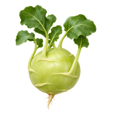 | [PNG](assets/visual_identity_catalog/kohlrabi-prototype.png) | Bulbo verde liso con hojas laterales. |

Método: once generaciones independientes con la herramienta integrada y referencias visuales aprobadas; sujeto aislado, fondo transparente y silueta legible. Se descartaron las primeras versiones de cabra y conejo por bordes/fondo residuales. Las vistas son de 192 px para revisión, no una prueba de producto. No se publicó ni vinculó ninguna imagen al catálogo operativo.

### Quinto lote · diez conceptos en orden, aprobado por Felipe

Los conceptos #31–40 producen once imágenes: el damasco fresco y el seco se representan por separado. La carne molida de cordero necesita su nombre visible, pues una imagen no prueba la especie. Para crema ácida y crema de leche se diferencian la consistencia y el recipiente, no solo el color.

| # de la tabla | Alimento(s) | Vista de revisión | Original | Observación |
|---:|---|---|---|---|
| 31 | Cordero molido crudo | 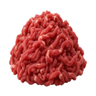 | [PNG](assets/visual_identity_catalog/lamb-mince-prototype.png) | Hebras de carne cruda; usar siempre con nombre. |
| 32 | Costilla de cerdo cruda | 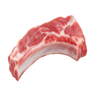 | [PNG](assets/visual_identity_catalog/pork-rib-prototype.png) | Corte rosado y hueso curvo visible. |
| 33 | Cranberry crudo | 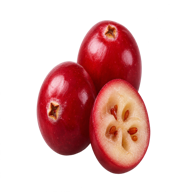 | [PNG](assets/visual_identity_catalog/cranberry-prototype.png) | Frutos rojos y corte claro; distinguir de cereza. |
| 34 | Crema ácida | 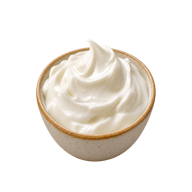 | [PNG](assets/visual_identity_catalog/sour-cream-prototype.png) | Consistencia espesa en cuenco bajo. |
| 35 | Crema de leche | 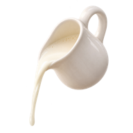 | [PNG](assets/visual_identity_catalog/milk-cream-prototype.png) | Fluida en jarrita; distinta de crema ácida. |
| 36 | Damasco crudo; seco | 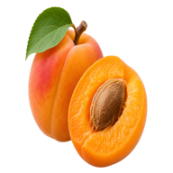 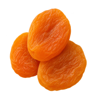 | [Fresco](assets/visual_identity_catalog/apricot-fresh-prototype.png) · [Seco](assets/visual_identity_catalog/apricot-dried-prototype.png) | Dos estados visuales explícitos. |
| 37 | Dátil seco | 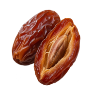 | [PNG](assets/visual_identity_catalog/date-prototype.png) | Fruto abierto con carozo. |
| 38 | Endivia cruda | 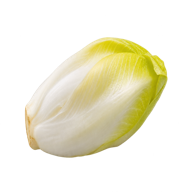 | [PNG](assets/visual_identity_catalog/endive-prototype.png) | Cogollo marfil alargado, no lechuga suelta. |
| 39 | Espárrago crudo; cocido | 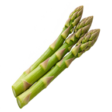 | [PNG](assets/visual_identity_catalog/asparagus-prototype.png) | Base cruda; decidir variante cocida antes de integrar. |
| 40 | Espinaca cruda; cocida | 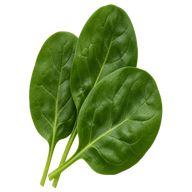 | [PNG](assets/visual_identity_catalog/spinach-prototype.png) | Base cruda; decidir variante cocida antes de integrar. |

Método: once generaciones independientes con la herramienta integrada, fondo transparente y vistas de 192 px. Los bocetos son propuestas de identidad, no pruebas de legibilidad final dentro de la aplicación. No se publicaron ni conectaron al catálogo operativo.

### Sexto lote · diez conceptos aprobados por Felipe

Se salta el garbanzo (#42), que ya tiene prototipo recuperado. El higo fresco y seco recibe dos versiones para distinguir estados; los bocetos de habas, kale y lechuga representan el alimento crudo, y sus variantes cocidas deben evaluarse antes de integrar.

| # de la tabla | Alimento(s) | Vista de revisión | Original | Observación |
|---:|---|---|---|---|
| 41 | Frambuesa cruda | 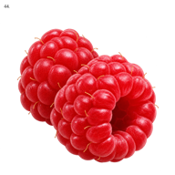 | [Versión aprobada](assets/visual_identity_catalog/raspberry-v2-prototype.png) · [Original conservado](assets/visual_identity_catalog/raspberry-prototype.png) · [Variante redondeada descartada](assets/visual_identity_catalog/raspberry-v3-prototype.png) | Dos frutos sin partes verdes, con cavidad y pelitos visibles; Felipe eligió `v2` definitivamente. |
| 43 | Granada cruda | 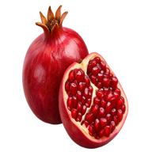 | [PNG](assets/visual_identity_catalog/pomegranate-prototype.png) | Corona y corte con arilos. |
| 44 | Grosella roja cruda | 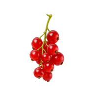 | [PNG](assets/visual_identity_catalog/red-currant-prototype.png) | Racimo pequeño de bayas translúcidas. |
| 45 | Guayaba cruda | 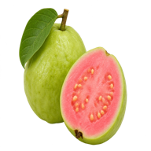 | [PNG](assets/visual_identity_catalog/guava-prototype.png) | Piel verde y mitad de pulpa rosada. |
| 46 | Habas crudas; cocidas | 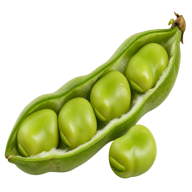 | [PNG](assets/visual_identity_catalog/fava-beans-prototype.png) | Vaina ancha; base cruda. |
| 47 | Hígado de pollo crudo | 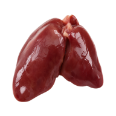 | [PNG](assets/visual_identity_catalog/chicken-liver-prototype.png) | Pieza lobulada color burdeos; nombre visible por especie. |
| 48 | Higo fresco; seco | 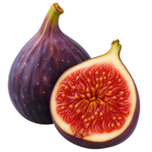 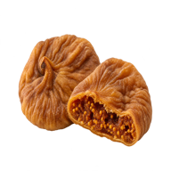 | [Fresco](assets/visual_identity_catalog/fig-fresh-prototype.png) · [Seco](assets/visual_identity_catalog/fig-dried-prototype.png) | Dos estados visuales explícitos. |
| 49 | Hinojo bulbo crudo | 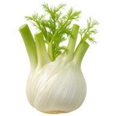 | [PNG](assets/visual_identity_catalog/fennel-prototype.png) | Bulbo blanco y hojas plumosas. |
| 50 | Kale crudo; cocido | 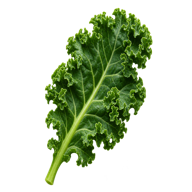 | [PNG](assets/visual_identity_catalog/kale-prototype.png) | Hoja rizada; base cruda. |
| 51 | Lechuga costina cruda | 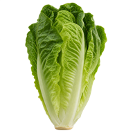 | [PNG](assets/visual_identity_catalog/romaine-prototype.png) | Cogollo alto y nervaduras claras. |

Método: once generaciones independientes con la herramienta de imágenes integrada; recortes con transparencia y vistas de 192 px. Inspección visual de todas las vistas pequeñas completada. No se integraron en la aplicación ni en el catálogo operativo.

### Séptimo lote · diez conceptos en orden, pendiente de revisión

Los conceptos #52–61 producen doce imágenes porque las lentejas se separan en roja seca, marrón seca y marrón cocida. La carne de cerdo representa un corte genérico y debe mostrarse con su nombre; las demás formas se diseñaron para distinguir alimentos parecidos a escala pequeña.

| # de la tabla | Alimento(s) | Vista de revisión | Original | Observación |
|---:|---|---|---|---|
| 52 | Lechuga francesa cruda | 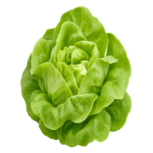 | [PNG](assets/visual_identity_catalog/butterhead-lettuce-prototype.png) | Roseta redonda de hojas suaves, distinta de costina. |
| 53 | Lechuga hoja roja cruda |  | [PNG](assets/visual_identity_catalog/red-leaf-lettuce-prototype.png) | Bordes rojizos ondulados. |
| 54 | Lenguado crudo |  | [PNG](assets/visual_identity_catalog/sole-prototype.png) | Pez plano, ojos en el mismo lado. |
| 55 | Lenteja roja seca; lenteja marrón seca; lenteja marrón cocida |    | [Roja seca](assets/visual_identity_catalog/lentil-red-dry-prototype.png) · [Marrón seca](assets/visual_identity_catalog/lentil-brown-dry-prototype.png) · [Marrón cocida](assets/visual_identity_catalog/lentil-cooked-prototype.png) | Tres estados visuales explícitos; no compartir una sola imagen. |
| 56 | Lomo de cerdo crudo |  | [PNG](assets/visual_identity_catalog/pork-loin-prototype.png) | Corte magro rosado con franja fina de grasa. |
| 57 | Lupino cocido |  | [PNG](assets/visual_identity_catalog/lupin-prototype.png) | Legumbres amarillas cocidas. |
| 58 | Mantequilla de maní natural |  | [PNG](assets/visual_identity_catalog/peanut-butter-prototype.png) | Pasta espesa sobre cuchara, sin envase. |
| 59 | Maracuyá cruda |  | [PNG](assets/visual_identity_catalog/passion-fruit-prototype.png) | Fruto morado y mitad con semillas. |
| 60 | Membrillo crudo |  | [PNG](assets/visual_identity_catalog/quince-prototype.png) | Silueta robusta amarilla, distinta de pera. |
| 61 | Mora cruda |  | [PNG](assets/visual_identity_catalog/blackberry-prototype.png) | Dos frutos oscuros con drupas visibles. |

Método: doce generaciones independientes con la herramienta integrada; recortes transparentes y vistas de 192 px. Se inspeccionaron visualmente las doce vistas pequeñas. No se integraron en la aplicación ni en el catálogo operativo.

| # | Alimento(s) | Propuesta gráfica | Tratamiento |
|---:|---|---|---|
| 1 | Acelga cocida; Acelga cruda | Tres hojas anchas verde profundo con pencas blancas visibles; prototipo ya recuperado. | Prototipo existente · `chard` |
| 2 | Alcachofa cocida | Alcachofa cerrada verde oliva, brácteas superpuestas y punta redondeada. | Boceto nuevo · `artichoke` |
| 3 | Alga kelp cruda | Cinta larga de alga pardo-oliva ondulada, sin parecer lechuga. | Boceto nuevo · `kelp` |
| 4 | Almejas cocidas | Concha de almeja redondeada abierta con carne beige; no usar 🦪 de ostra como sustituto definitivo. | Boceto nuevo · `clam` |
| 5 | Almendras | Tres almendras beige, una partida que muestre interior claro. | Boceto nuevo · `almond` |
| 6 | Anchoa cruda | Pez pequeño plateado, cuerpo fino, lomo azul oscuro. | Boceto nuevo · `anchovy` |
| 7 | Apio crudo | Dos tallos verdes acanalados con hojas pequeñas en la punta. | Boceto nuevo · `celery` |
| 8 | Apio nabo crudo | Bulbo nudoso beige con pequeños brotes verdes; no apio en rama. | Boceto nuevo · `celeriac` |
| 9 | Arándanos | 🫐 Sustituir la manzana actual por arándanos azules. | Cambiar emoji · `blueberry` |
| 10 | Arvejas de ojo negro cocidas; Arvejas de ojo negro secas | Tres granos crema con el ojo negro bien visible. | Boceto nuevo · `black_eyed_peas` |
| 11 | Arvejas partidas cocidas | Pequeño montón de medias arvejas verdes partidas. | Boceto nuevo · `split_peas` |
| 12 | Arvejas verdes cocidas | 🫛 Sustituir el símbolo actual por vaina abierta con arvejas. | Cambiar emoji · `green_peas` |
| 13 | Atún en agua drenado | Porción de atún rosado drenado, hebras compactas; no pez entero. | Boceto nuevo · `tuna` |
| 14 | Avena tradicional | Copos de avena beige en pequeño montón; sin bowl genérico. | Boceto nuevo · `oats` |
| 15 | Bacalao crudo | Bacalao gris plateado con aleta dorsal marcada. | Boceto nuevo · `cod` |
| 16 | Berro crudo | Ramita de berro con hojas redondas pequeñas. | Boceto nuevo · `watercress` |
| 17 | Betarraga cocida; Betarraga cruda | Betarraga redonda color vino con raíz fina y hojas; base compartida. | Boceto nuevo · `beet` |
| 18 | Bok choy cocido; Bok choy crudo | Manojo de hojas verde oscuro y tallos blancos anchos. | Boceto nuevo · `bok_choy` |
| 19 | Caqui crudo | Caqui naranja con cáliz verde de cuatro puntas. | Boceto nuevo · `persimmon` |
| 20 | Carambola cruda | Carambola amarilla con una rodaja en estrella. | Boceto nuevo · `starfruit` |
| 21 | Carne de cabra cruda | Corte magro rojo oscuro; distintivo de cabra sin usar animal vivo. | Boceto nuevo · `goat_meat` |
| 22 | Carne de conejo cruda | Corte pálido rosado y pequeño; evitar caricatura de conejo. | Boceto nuevo · `rabbit_meat` |
| 23 | Carne molida de vacuno magra cruda | Montículo de carne molida roja con hebras definidas. | Boceto nuevo · `ground_beef` |
| 24 | Cebollín crudo | Tres cebollines largos, bulbos blancos y tallos verdes. | Boceto nuevo · `scallion` |
| 25 | Chirimoya cruda | Chirimoya verde de escamas suaves, una mitad blanca con semillas negras. | Boceto nuevo · `cherimoya` |
| 26 | Chirivía cocida; Chirivía cruda | Raíz cónica crema con hojas cortas, distinta de zanahoria. | Boceto nuevo · `parsnip` |
| 27 | Ciruela cruda; Ciruela seca | Ciruela fresca morada con pulpa amarilla; para la seca, variante arrugada oscura. | Boceto nuevo · `plum` |
| 28 | Clara de huevo | Clara translúcida en plato pequeño, sin yema. | Boceto nuevo · `egg_white` |
| 29 | Coliflor cocida; Coliflor cruda | Cabeza blanca de coliflor con hojas verdes. | Boceto nuevo · `cauliflower` |
| 30 | Colinabo crudo | Bulbo verde claro redondo con tallos laterales. | Boceto nuevo · `kohlrabi` |
| 31 | Cordero molido crudo | Carne de cordero molida roja en hebras; evitar oveja viva. | Boceto nuevo · `lamb` |
| 32 | Costilla de cerdo cruda | Costilla cruda rosada con hueso curvo visible. | Boceto nuevo · `pork_rib` |
| 33 | Cranberry crudo | Tres cranberries rojos pequeños, una cortada para distinguir de cereza. | Boceto nuevo · `cranberry` |
| 34 | Crema ácida | Crema blanca espesa con remolino suave en cuenco bajo. | Boceto nuevo · `sour_cream` |
| 35 | Crema de leche | Crema de leche fluida blanca en jarrita, distinta de crema ácida. | Boceto nuevo · `cream` |
| 36 | Damasco crudo; Damasco seco | Damasco fresco naranja con mitad y carozo; versión seca más oscura y arrugada. | Boceto nuevo · `apricot` |
| 37 | Dátil seco | Dos dátiles marrón ámbar, uno abierto con carozo. | Boceto nuevo · `date` |
| 38 | Endivia cruda | Cogollo alargado blanco-verde de hojas apretadas. | Boceto nuevo · `endive` |
| 39 | Espárrago cocido; Espárrago crudo | Tres espárragos verdes con puntas compactas. | Boceto nuevo · `asparagus` |
| 40 | Espinaca cocida; Espinaca cruda | Hojas de espinaca ovaladas verde oscuro, nervadura discreta. | Boceto nuevo · `spinach` |
| 41 | Frambuesa cruda | Frambuesa roja con drupas visibles y cavidad central. | Boceto nuevo · `raspberry` |
| 42 | Garbanzos cocidos; Garbanzos secos | Tres garbanzos beige con pico característico; prototipo ya recuperado. | Prototipo existente · `chickpea` |
| 43 | Granada cruda | Granada roja coronada con corte mostrando arilos. | Boceto nuevo · `pomegranate` |
| 44 | Grosella roja cruda | Racimo colgante de bayas rojas translúcidas. | Boceto nuevo · `red_currant` |
| 45 | Guayaba cruda | Guayaba verde clara con mitad rosada y semillas. | Boceto nuevo · `guava` |
| 46 | Habas cocidas; Habas crudas | Vaina ancha abierta con habas verdes grandes. | Boceto nuevo · `fava_beans` |
| 47 | Hígado de pollo crudo | Hígado de pollo liso color burdeos, lobulado. | Boceto nuevo · `chicken_liver` |
| 48 | Higo fresco; Higo seco | Higo fresco morado abierto con centro rojo; seco en variante parda. | Boceto nuevo · `fig` |
| 49 | Hinojo bulbo crudo | Bulbo blanco de hinojo con tallos y hojas plumosas. | Boceto nuevo · `fennel` |
| 50 | Kale cocido; Kale crudo | Hoja rizada verde oscuro con tallo central. | Boceto nuevo · `kale` |
| 51 | Lechuga costina cruda | Cogollo alto de lechuga costina, hojas largas y nervadura. | Boceto nuevo · `romaine_lettuce` |
| 52 | Lechuga francesa cruda | Lechuga francesa redonda, hojas suaves formando roseta. | Boceto nuevo · `butterhead_lettuce` |
| 53 | Lechuga hoja roja cruda | Hojas de lechuga onduladas con bordes morado rojizo. | Boceto nuevo · `red_leaf_lettuce` |
| 54 | Lenguado crudo | Pez plano ovalado marrón con ambos ojos del mismo lado. | Boceto nuevo · `sole` |
| 55 | Lenteja roja seca; Lentejas cocidas; Lentejas secas | Lentejas en pequeño montón; variante roja cobriza separada de marrones. | Boceto nuevo · `lentil` |
| 56 | Lomo de cerdo crudo | Lomo de cerdo rosado con franja fina de grasa. | Boceto nuevo · `pork_loin` |
| 57 | Lupino cocido | Granos de lupino amarillos redondos en pequeño grupo. | Boceto nuevo · `lupin` |
| 58 | Mantequilla de maní natural | Untada espesa color maní sobre cuchara, sin confundir con maní entero. | Boceto nuevo · `peanut_butter` |
| 59 | Maracuyá cruda | Maracuyá morada partida con pulpa amarilla y semillas. | Boceto nuevo · `passion_fruit` |
| 60 | Membrillo crudo | Membrillo amarillo en forma de pera robusta con hoja. | Boceto nuevo · `quince` |
| 61 | Mora cruda | Mora negra brillante compuesta por drupas visibles. | Boceto nuevo · `blackberry` |
| 62 | Mozzarella fresca | Bola blanca de mozzarella fresca con superficie húmeda. | Icono original · `mozzarella` |
| 63 | Nabo cocido; Nabo crudo | Nabo blanco con hombros morados y hojas verdes. | Icono original · `turnip` |
| 64 | Ñame cocido | Ñame de piel marrón rugosa con corte de pulpa clara. | Icono original · `yam` |
| 65 | Nueces | Nuez con cáscara surcada y mitad abierta de interior lobulado. | Icono original · `walnut` |
| 66 | Okra cruda | Dos vainas verdes de okra, una cortada en estrella. | Icono original · `okra` |
| 67 | Ostiones cocidos | Concha de ostión en abanico con carne clara; no pez. | Icono original · `scallop` |
| 68 | Paleta de cerdo cruda | Paleta de cerdo rosada de forma irregular con grasa moderada. | Icono original · `pork_shoulder` |
| 69 | Palmito crudo | Dos cilindros blancos de palmito, uno con corte circular. | Icono original · `heart_of_palm` |
| 70 | Panceta de cerdo cruda | Corte rectangular de panceta cruda con capas rosadas y blancas. | Icono original · `pork_belly` |
| 71 | Papaya cruda | Papaya ovalada naranja partida con semillas negras. | Icono original · `papaya` |
| 72 | Pavo molido crudo | Carne molida de pavo rosada pálida en hebras. | Icono original · `ground_turkey` |
| 73 | Pechuga de pavo cocida | Pechuga de pavo cocida, lonchas claras con borde dorado. | Icono original · `turkey_breast` |
| 74 | Pechuga de pollo cocida; Pechuga de pollo cruda sin piel | Pechuga de pollo reconocible; variante cruda rosada y cocida marfil-dorada. | Icono original · `chicken_breast` |
| 75 | Pernil de cerdo crudo | Pernil crudo rosado, silueta de pierna con hueso visible. | Icono original · `pork_leg` |
| 76 | Pollo entero crudo con piel | Pollo entero crudo eviscerado, sin confundir con ave viva. | Icono original · `whole_chicken` |
| 77 | Pollo molido crudo | Carne molida de pollo rosada clara en hebras. | Icono original · `ground_chicken` |
| 78 | Pomelo crudo | Pomelo amarillo rosado partido con gajos rosados. | Icono original · `grapefruit` |
| 79 | Porotos adzuki cocidos; Porotos adzuki secos | Porotos adzuki pequeños rojo vino, uno con marca blanca. | Icono original · `adzuki_beans` |
| 80 | Porotos blancos cocidos; Porotos blancos secos | Porotos blancos ovalados color marfil. | Icono original · `white_beans` |
| 81 | Porotos cranberry cocidos; Porotos cranberry secos | Porotos cranberry crema con vetas rosadas. | Icono original · `cranberry_beans` |
| 82 | Porotos mung cocidos; Porotos mung secos | Porotos mung pequeños verdes con línea clara. | Icono original · `mung_beans` |
| 83 | Porotos negros cocidos; Porotos negros secos | Porotos negros brillantes con hilio blanco. | Icono original · `black_beans` |
| 84 | Porotos pintos cocidos; Porotos pintos secos | Porotos pintos beige con manchas marrones. | Icono original · `pinto_beans` |
| 85 | Porotos rojos cocidos; Porotos rojos secos | Porotos rojos grandes en forma de riñón. | Icono original · `kidney_beans` |
| 86 | Puerro cocido; Puerro crudo | Puerro largo con base blanca gruesa y hojas verde azuladas. | Icono original · `leek` |
| 87 | Quinoa cocida | Montículo de quinoa cocida con granos pequeños y germen visible. | Icono original · `quinoa` |
| 88 | Rábano crudo | Rábano rojo redondo con punta blanca y hojas. | Icono original · `radish` |
| 89 | Repollo blanco crudo | Cabeza compacta de repollo blanco verde pálido. | Icono original · `white_cabbage` |
| 90 | Repollo de Bruselas cocido; Repollo de Bruselas crudo | Dos repollitos de Bruselas verdes, uno cortado mostrando capas. | Icono original · `brussels_sprouts` |
| 91 | Repollo morado cocido; Repollo morado crudo | Repollo morado con corte mostrando espiral de hojas. | Icono original · `red_cabbage` |
| 92 | Requesón bajo en grasa | Requesón blanco de grumos pequeños en cuenco. | Icono original · `cottage_cheese` |
| 93 | Ricotta entera | Ricotta blanca cremosa, textura fina en cuenco distinto del requesón. | Icono original · `ricotta` |
| 94 | Rúcula cruda | Hojas de rúcula lobuladas y alargadas verde intenso. | Icono original · `arugula` |
| 95 | Salmón cocido; Salmón crudo | Filete de salmón naranja con líneas blancas; variante cruda/cocida de color y textura. | Icono original · `salmon` |
| 96 | Soya cocida; Soya seca | Granos de soya redondos amarillo claro en pequeño grupo. | Icono original · `soybeans` |
| 97 | Taro cocido | Tubérculo de taro marrón con corte blanco punteado morado. | Icono original · `taro` |
| 98 | Tempeh cocido | Bloque de tempeh beige con granos de soya compactados visibles. | Icono original · `tempeh` |
| 99 | Tilapia cruda | Tilapia plateada de cuerpo alto con aleta dorsal marcada. | Icono original · `tilapia` |
| 100 | Tofu blando; Tofu firme | Bloque blanco de tofu; blando con bordes suaves, firme con aristas nítidas. | Boceto nuevo · `tofu` |
| 101 | Trucha arcoíris cruda | Trucha arcoíris con banda rosada lateral y puntos negros. | Boceto nuevo · `trout` |
| 102 | Yogur griego natural sin azúcar; Yogur natural descremado sin azúcar; Yogur natural entero sin azúcar | Yogur blanco en cuenco con remolino; no representar diferencias de grasa sin evidencia visible. | Boceto nuevo · `yogurt` |
| 103 | Yuca cruda | Raíz de yuca alargada marrón con corte de pulpa blanca. | Icono original · `cassava` |
| 104 | Zapallo butternut cocido; Zapallo butternut crudo | Zapallo butternut beige en forma de pera con mitad naranja. | Icono original · `butternut_squash` |
| 105 | Zapallo camote cocido; Zapallo camote crudo | Gajo de zapallo camote de pulpa naranja intensa y corteza verde. | Icono original · `pumpkin_squash` |
| 106 | Zapallo italiano cocido; Zapallo italiano crudo | Zapallo italiano verde alargado con corte circular claro. | Icono original · `zucchini` |

## Reglas para revisión

- El nombre del alimento siempre acompaña la imagen; color solo no basta para distinguirlo.
- Reutilizar un concepto entre variantes cuando la forma se conserva; preparar variantes del mismo concepto para crudo/cocido o fresco/seco cuando el aspecto cambie claramente (por ejemplo ciruela, damasco, higo, salmón y pechuga de pollo).
- Antes de aprobar cada arte: reconocimiento a 20 px, contraste en temas claro/oscuro, transparencia real, consistencia con acelga/garbanzo y fuente/autoría trazable.
- Las fichas alimentarias y sus nutrientes no cambian por una decisión de identidad visual. Esta propuesta no implica publicación ni una nueva ficha en catálogo.
